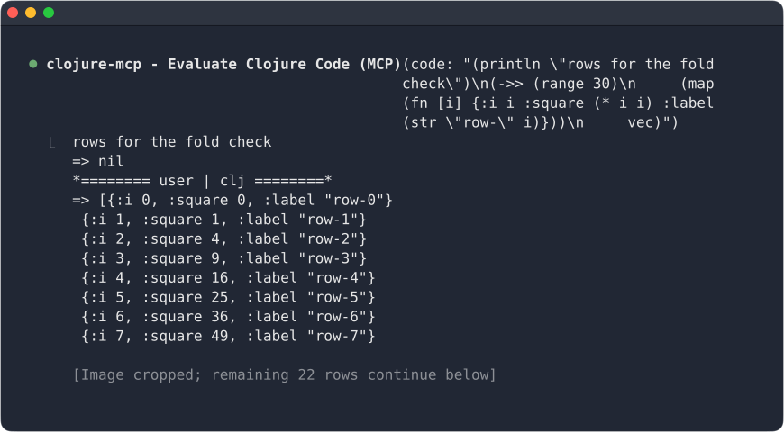
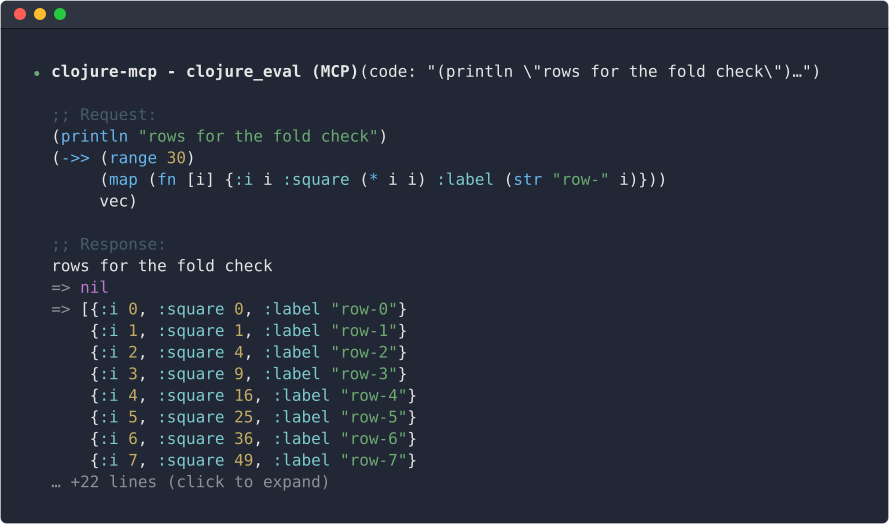

# clojure-mcp-view

A [Claude Code](https://code.claude.com) plugin that shows
[clojure-mcp](https://github.com/bhauman/clojure-mcp) evals readably in the expanded view
(ctrl+o): the code Claude sent, with real newlines, under the call's row, and the response
with each value lined up after its `=>`. The normal view and what the model reads are
unchanged.

For the Claude Code CLI in a terminal only: it draws in the ctrl+o view, in the terminal's
own palette colors, so the desktop app and IDE extensions keep their usual view.

Before:



After:



- `/clj-view request off` — hide the added request code block.
- `/clj-view response off` — use Claude Code's default response display.
- `/clj-view highlight off` — turn off syntax highlighting.
- `/clj-view fold 10` — set how many lines appear before folding.
- `/clj-view fold off` — show all lines.
- `/clj-view` — show the current settings.

## Install

```sh
claude plugin install clojure-mcp-view --marketplace shaunlebron/claude-clojure-mcp-view
```

This adds the repository as the marketplace `clojure-mcp-view`, then installs the plugin from it.

Or, for everyone working in a project, add it to the project's `.claude/settings.json`:

```json
{
  "extraKnownMarketplaces": {
    "clojure-mcp-view": {
      "source": { "source": "github", "repo": "shaunlebron/claude-clojure-mcp-view" }
    }
  },
  "enabledPlugins": { "clojure-mcp-view@clojure-mcp-view": true }
}
```

Update with `claude plugin update clojure-mcp-view`.

## Settings

Everything is on by default. Turn parts off with the `/clj-view` command; the settings are
saved and apply to every session:

```
/clj-view                    show the current settings
/clj-view request off        ;; Request: the eval's code under its row
/clj-view response off       ;; Response: printed output and each => value
/clj-view highlight off      draw both as plain text, not highlighted
/clj-view fold 10            fold a request or response past 10 lines (the default)
/clj-view fold off           never fold
```

A folded section ends with `… +n lines (click to expand)`, and an unfolded one with
`(click to fold)`. Clicks reach the plugin only in Claude Code's fullscreen mode.

- Depends on clojure-mcp's text format (`=> ` before each value, `*==== ns | clj ====*`
  after each form's output); tested with clojure-mcp v0.6.0 and Claude Code 2.1.319.

## Developing

The mod is `src/main.cljs` and its tests are `src/test.cljs`, both in
[squint](https://github.com/squint-cljs/squint). Needs node and
[babashka](https://babashka.org). `dist/` is the plugin: `plugin.json`, `hooks.json` and
`types.d.ts` are edited there, and the build writes `main.jsx` beside them.

```sh
npm install    # once: squint-cljs, esbuild and highlight.js, pinned in package.json
npm run build  # bin/build.bb: compile src/main.cljs and src/test.cljs, then bundle each
npm test       # build, then claude plugin test dist against the compiled module
bin/screenshot.bb  # redraw screenshot.svg and screenshot-before.svg
```

To try a change in Claude Code, run a session in this folder with the checkout loaded, and a
Clojure REPL for its evals (`.mcp.json` connects clojure-mcp to port 1667):

```sh
clj -M:nrepl                  # in one terminal: deps.edn's alias, an nREPL on port 1667
claude --plugin-dir dist      # in another; ask it to eval something, then ctrl+o
```

Use a JVM REPL, not `bb nrepl-server`: clojure-mcp asks the REPL to pretty-print each
value, and babashka's nREPL ignores that, so a long value arrives on one line and never
folds.

The session watches the folder, so a build reloads the plugin. Leave the released plugin
uninstalled at user scope, or both copies load in this folder.

`.mcp.json` pins the clojure-mcp version the plugin is tested with. Its output format (the
`=> ` lines and namespace footers) is what the plugin parses, so when clojure-mcp releases
a new version, bump it there, check that evals still draw in ctrl+o, and update the tested
version noted under Settings.

`bin/build.bb` adjusts squint's output for Claude Code: a mod imports only the plugin's own files
(so esbuild bundles in the parts of squint's runtime the mod uses), its mod loader accepts
`register` and hooks only as `const` or `function` bindings (squint and esbuild emit `var`),
and `claude plugin test` runs only `*.test.ts` files (so each compiled test is written as one).
It also copies package.json's version into plugin.json.

## Releasing

Note each change under `## Unreleased` in [CHANGELOG.md](CHANGELOG.md) as you make it, then:

```sh
bin/release.bb patch   # or minor, major
```

`main` holds no built files. `bin/release.bb` refuses a release with no Unreleased notes.
It bumps the version, builds and tests, dates the notes as the new version, and commits
that, then commits the plugin (`dist/`, with `LICENSE` and `CHANGELOG.md`) to the `release`
branch, tags that commit `vX.Y.Z`, and pushes.

The repo's root `.claude-plugin/` holds only `marketplace.json`, the catalog that
`claude plugin install --marketplace shaunlebron/claude-clojure-mcp-view` reads from `main`.
Claude Code looks for it at that path, so it stays at the root. It points the install at
the `release` branch; pin a version with its tag as `ref`. The plugin's own manifest is
`dist/.claude-plugin/plugin.json`.

## License

Copyright © 2026 Shaun Williams. Distributed under the Eclipse Public License 2.0, the same as
clojure-mcp; see [LICENSE](LICENSE).

The published `main.jsx` bundles parts of the
[squint](https://github.com/squint-cljs/squint) runtime, Copyright © 2022 - 2026 Michiel Borkent,
under the Eclipse Public License 1.0, and
[highlight.js](https://github.com/highlightjs/highlight.js), Copyright © 2006 Ivan Sagalaev,
under the BSD 3-Clause License, whose text is at the top of `main.jsx`.
